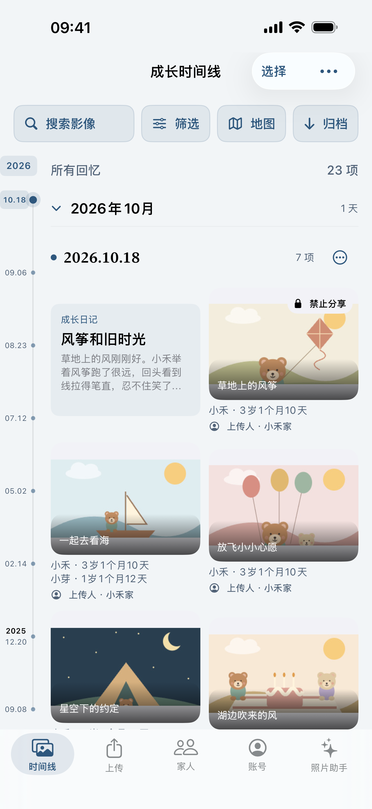
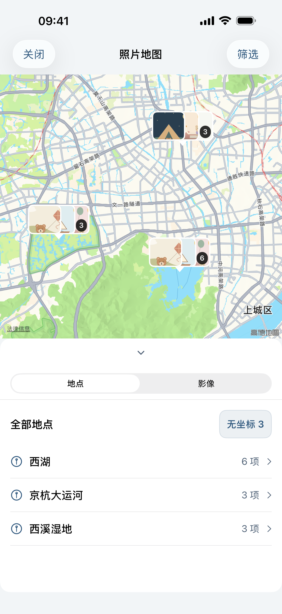
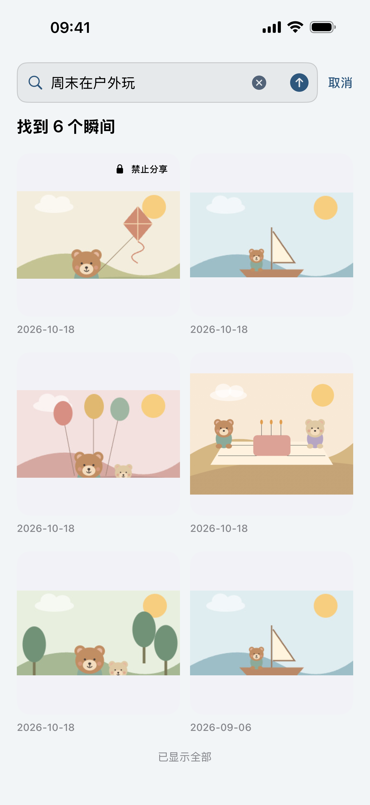
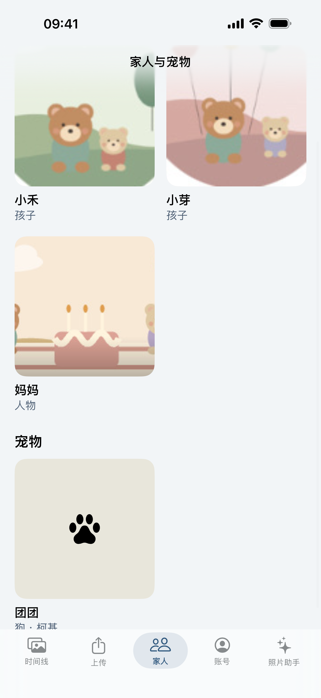
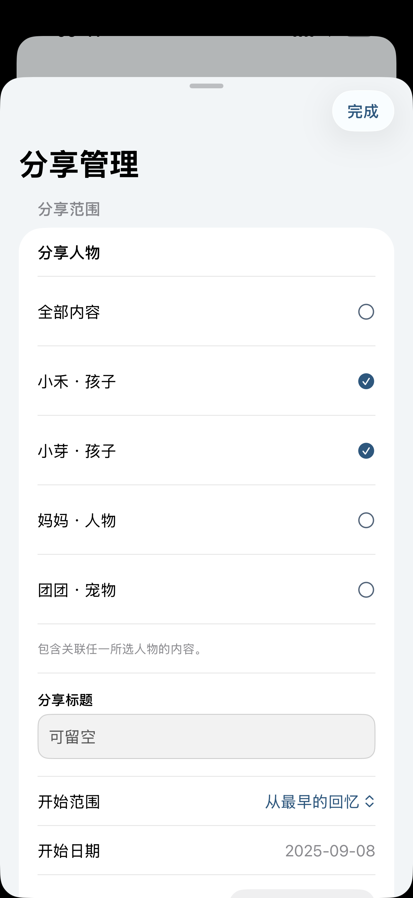
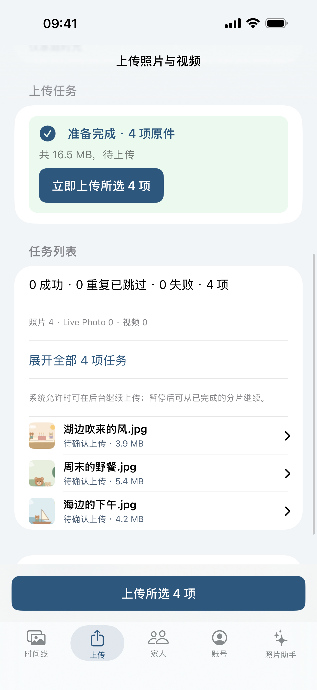
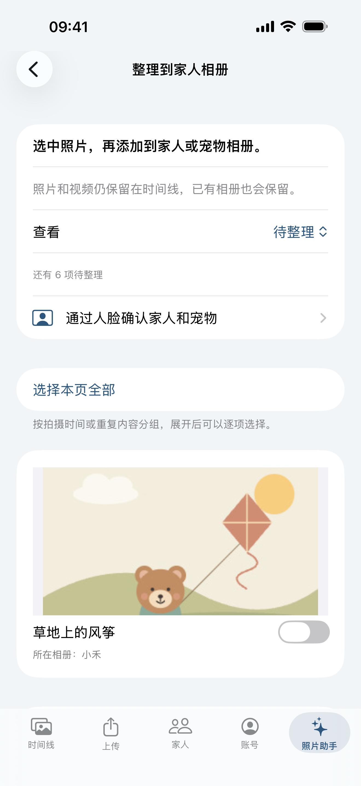
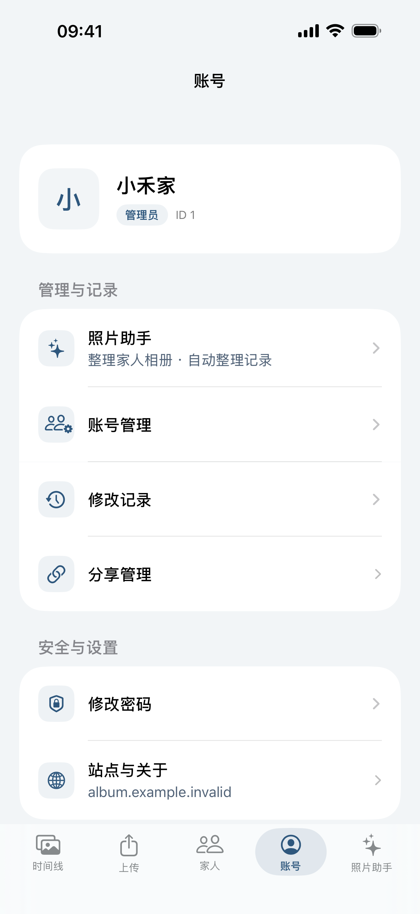
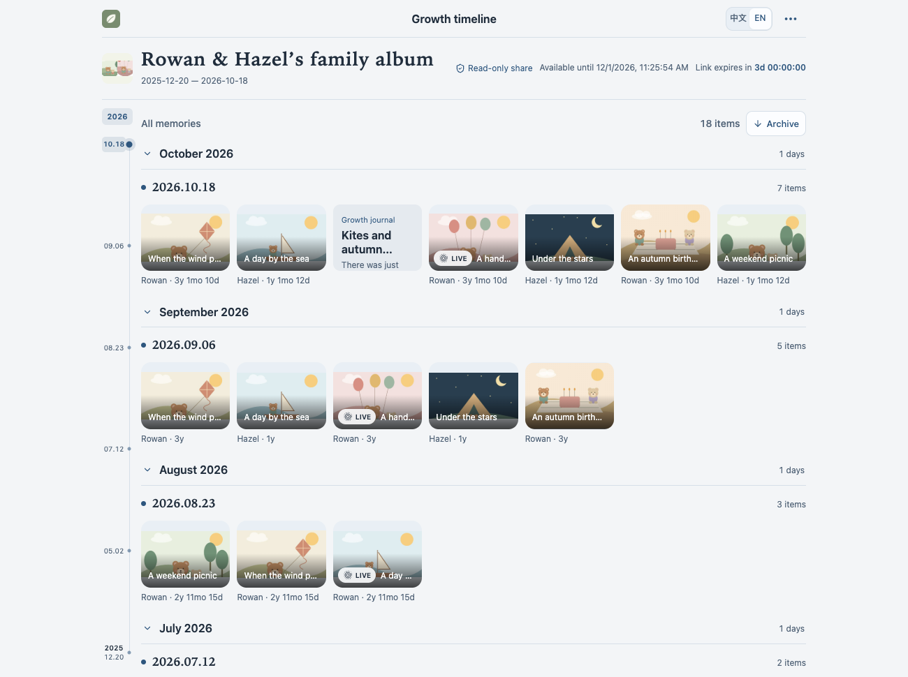

# Yearly

[简体中文](README.md) · **English**

Yearly is a self-hosted family photo archive. Photos, videos, Live Photos, and journals share one growth timeline. Family members can browse the same album on iPhone, Android, or the web and send relatives a link that expires.

[Gallery](#gallery) · [Features](#features) · [Quick start](#quick-start) · [Mobile installation](#mobile-installation) · [Deployment and maintenance](#deployment-and-maintenance)

## Gallery

### iPhone

| Growth timeline | Photo map | Growth journal |
| :---: | :---: | :---: |
| <a href="docs/images/demo-ios-timeline.png"></a> | <a href="docs/images/demo-ios-map.png"></a> | <a href="docs/images/demo-ios-diary.png"></a> |

| Smart search | People and pets | Expiring shares |
| :---: | :---: | :---: |
| <a href="docs/images/demo-ios-search.png"></a> | <a href="docs/images/demo-ios-family.png"></a> | <a href="docs/images/demo-ios-share.png"></a> |

<details>
<summary>See original uploads, media preview, Photo Assistant, and account settings</summary>

| Original uploads | Media preview | Photo Assistant | Account |
| :---: | :---: | :---: | :---: |
| <a href="docs/images/demo-ios-upload.png"></a> | <a href="docs/images/demo-ios-preview.png"></a> | <a href="docs/images/demo-ios-assistant.png"></a> | <a href="docs/images/demo-ios-account.png"></a> |

</details>

### Shared timeline on the web

Recipients can open a read-only album without signing in. Like the iOS timeline, the shared page groups memories by month and day. Recipients can drag the date rail, browse media full-screen, or open a journal entry in its own reader. For linked child profiles with growth tracking enabled, photos and videos can show the child's age based on their birthday and the capture date. [Sharing guide](docs/en/sharing.md)

<a href="docs/images/demo-share-en.png"></a>

These screenshots show the running iOS simulator app and web interface with fictional profiles, media, and journals. Select an image to view it at full size. [Screenshot notes](docs/images/ios-screenshots.md)

## Features

- **Browse and organize.** Group photos, videos, Live Photos, and journals by day, collapse months, and jump with the date rail. Mix folders and media within a day, move several items together, and reorder them. The iOS photo map groups geotagged media and lets you browse everything captured at a location. [iOS photo map](docs/en/storage-and-metadata.md#ios-photo-map)
- **Record growth.** Create individual profiles for children, other family members, and pets. Link a memory to several profiles and browse their timelines. Children's profiles support ages at capture and growth milestones. Birthdays are optional. [People and pets](docs/en/pets.md)
- **Keep originals.** Batch-import originals from the iPhone photo library. A Live Photo's still image and paired MOV upload together as one item. The queue supports pausing, retrying, and continuing transfers in the background. Originals are stored in private OSS, with thumbnails or compressed previews for browsing. [iOS uploads and background transfers](ios/README.md)
- **Share for a limited time.** Create a read-only link scoped to profiles, archive dates, or specific media. Links last from one hour to seven days and can be revoked early. Changes to content sharing permissions apply to existing links. The iOS app marks media with sharing disabled. [Share scope and permissions](docs/en/sharing.md)
- **Manage family access.** Each deployment serves one family. Administrators create accounts and set member or read-only access. The server checks editing permissions and records changes. Deleted media and journals can be restored from the trash.

### Smart search and Photo Assistant

Describe a scene such as “playing in the sand by the sea” to find photos or videos even when the indexed description uses different words. Search respects your current filters and access permissions, and you can browse all matching results 20 at a time. Administrators can review face and dog matches, check image quality, add media to family albums, and enable automatic tags.

Smart search is off by default. Enabling it requires an OpenAI API key and monthly budget on the server, followed by an indexing run. Indexing sends photo previews or sampled video frames and uses the still image for Live Photos. Search uses the stored descriptions. [Smart search setup](docs/ai-search.md) · [Face matching and album organization](docs/face-matching.md)

## Quick start

Local development requires Python 3.12, Node.js 22.12+, and MySQL 5.7.8+. Full upload and preview functionality also requires a private Alibaba Cloud OSS bucket with access permissions and CORS configured. [Create the MySQL database](docs/en/deployment.md#2-create-application-databases-in-mysql) · [Configure OSS](docs/en/storage-and-metadata.md)

1. Install dependencies and prepare the test configuration.

   ```bash
   git clone https://github.com/NiuXiangQian/yearly.git
   cd yearly
   python3.12 -m venv .venv
   .venv/bin/pip install -r backend/requirements.txt
   (cd frontend && npm ci)
   cp -n .env.test.example .env.test
   chmod 600 .env.test
   ```

2. Set the test MySQL connection, `SESSION_SECRET`, and OSS values in `.env.test`. Use a dedicated database account and a database name ending in `_test`. Generate a random session secret locally.

   ```bash
   .venv/bin/python -c 'import secrets; print(secrets.token_urlsafe(48))'
   ```

3. Migrate the database, create the first administrator, and start the app.

   ```bash
   ./scripts/manage.sh test migrate
   ./scripts/manage.sh test create-admin your-admin-name
   ./scripts/start-local.sh
   ```

Open [http://127.0.0.1:5173/](http://127.0.0.1:5173/) to sign in. Press `Ctrl+C` to stop the frontend, API, and video preview worker together.

## Mobile installation

| Client | Installation |
| --- | --- |
| **iOS 16+** | Open `ios/Yearly.xcodeproj` in full Xcode, configure your Apple Team and signing, connect an iPhone with Developer Mode enabled, and run the app. [iOS build and signing guide](ios/README.md) |
| **Android 8.0+** | Open `android/` in Android Studio or run `./scripts/android.sh release` from the repository root to build the APK. [Android build and installation guide](android/README.md) |

Enter the full HTTPS address of your family site in the app, such as `https://example.com/yearly/`. The phone must be able to reach the site and trust its certificate. Sign in with your existing family account.

## Deployment and maintenance

The backend uses FastAPI, SQLAlchemy, Alembic, and MySQL. The web client uses Vue 3 and TypeScript. The native apps use SwiftUI and Jetpack Compose. Production uses a separate `.env.production` configuration and database. Nginx serves HTTPS, and systemd runs the API and video preview worker. Back up your data before migrating an existing deployment. [Deployment guide](docs/en/deployment.md)

Original capture metadata is stored separately from manual corrections. Generating previews leaves the originals intact. MySQL stores metadata and relationships. A complete backup also includes the original OSS objects and the manifest. [Storage and metadata](docs/en/storage-and-metadata.md) · [Backup and restore](docs/en/backup-restore.md)

The following commands cover routine checks. The full backend and frontend suite uses a dedicated test MySQL database.

```bash
(cd frontend && npm test && npm run build)
./scripts/test.sh
./scripts/ios.sh verify
```

[Verification scope](docs/en/verification.md) · [Deployment templates](deploy/) · [Management scripts](scripts/)
