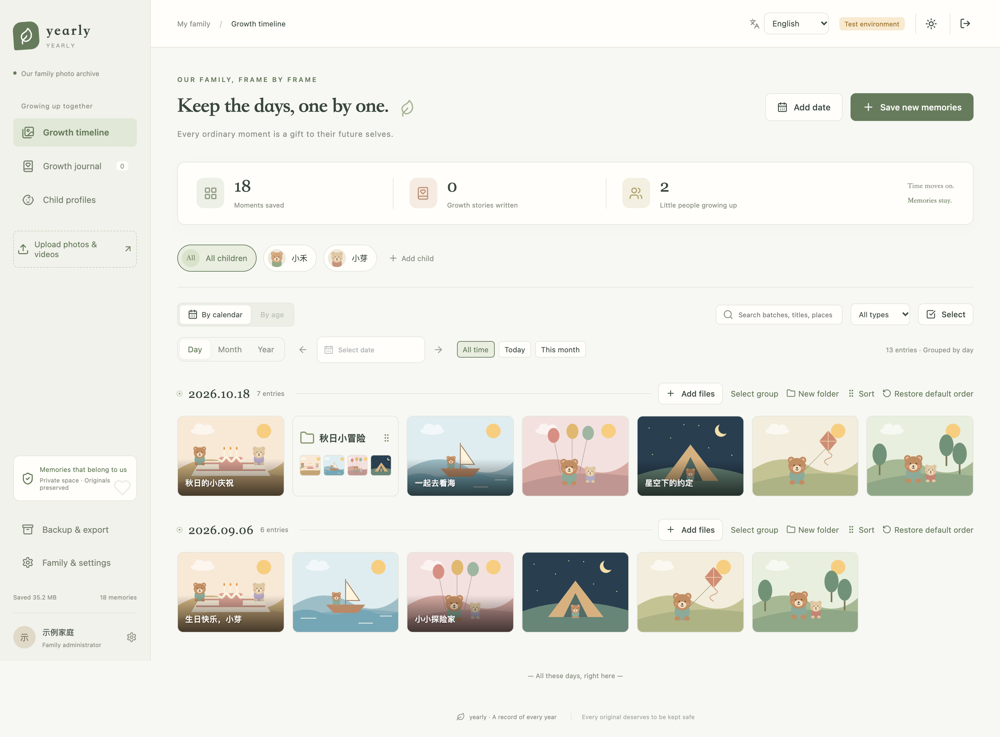
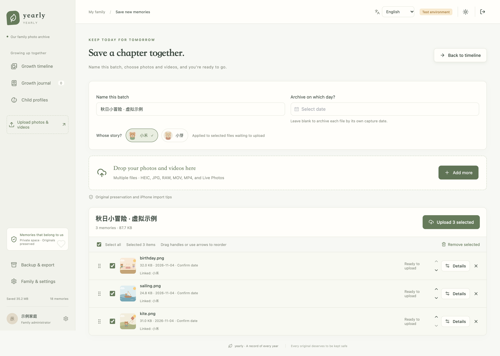
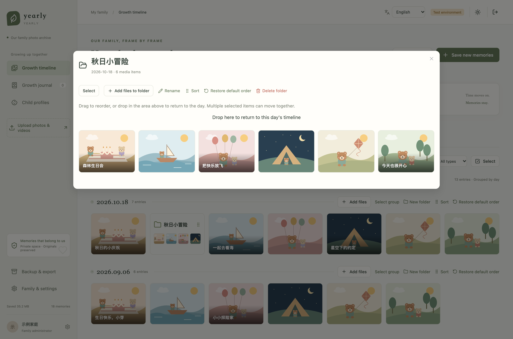
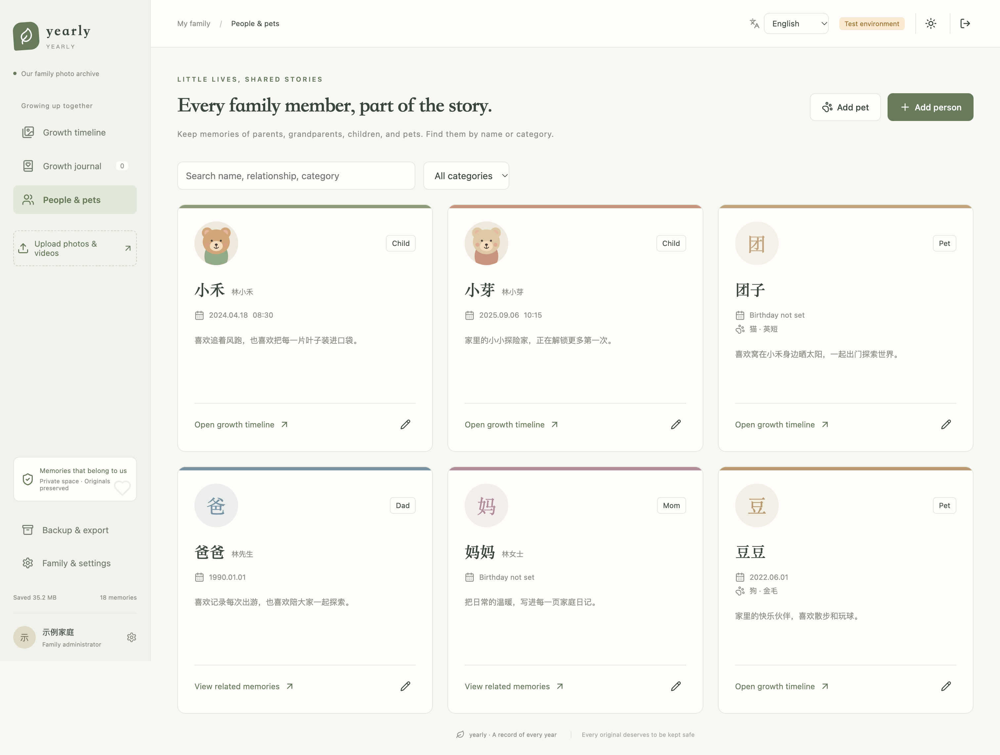

# yearly

[简体中文（默认）](README.md) | **English**

**Keep every chapter of growing up.**

A self-hosted, private family photo and video archive. Organize photos, videos, and growth journals by date, person, and pet, so the moments that matter remain easy to find years later.

Daily timeline · Expiring read-only shares · People and pet profiles · Drag-and-drop folders · Compressed previews · Original-file backups

[Screenshots](#screenshots) · [Sharing page](#share-a-read-only-timeline) · [Quick start](#quick-start) · [Deployment](docs/en/deployment.md) · [Backup and restore](docs/en/backup-restore.md)

## Screenshots

These screenshots show the actual application with isolated fictional data. Names, birthdays, entries, and counts are fictional; avatars and media use original sample illustrations. No real family photos or accounts are included. The main gallery shows the English interface; the sharing examples use Simplified Chinese. Both languages are supported. Family names and user-written content are preserved in their original language. All screenshots are lossless PNGs captured at 2× resolution (3024px wide); open an image or its full-resolution link for details.

### A daily timeline you can organize your way

Drag photos, videos, and folders into any order within a day. Folders display small previews, and custom titles appear over the images.



[Full-resolution timeline screenshot](docs/images/demo-timeline-en.png)

### Organize a whole batch before uploading

Name a batch, select people and pets, and choose an archive date. The compact file list supports bulk selection, drag-to-reorder, and file details.



[Full-resolution upload screenshot](docs/images/demo-upload-en.png)

### Share a read-only timeline

Set sharing permissions while editing files, folders, or timeline days. Creating a link only requires a date range and a lifetime of 1 hour to 7 days. Links can be revoked at any time.

Recipients browse compressed previews without signing in. They can switch chronological order, collapse months, and expand days beyond eight entries. The timeline on the left marks dates with dots: drag to preview a date, then release to jump and open the corresponding month.


[Full-resolution sharing screenshot](docs/images/demo-share.png) · [Sharing guide and permissions](docs/en/sharing.md)

<details>
<summary>View link creation and timeline dragging</summary>

Start from the earliest date, one year ago, six months ago, or a custom date. There is no per-file picker during link creation.


Dragging previews the date; releasing loads the target content on demand.


</details>

<details>
<summary>View folder organization and people / pet profiles</summary>

### Keep a story together in a folder

Select multiple items, append uploads, drag items into or out of folders, reorder their contents, and restore the default order.



### People and pets, sharing memories

Create profiles for parents, grandparents, children, friends, and pets. Set custom relationships and pet categories, with optional birthdays. Growth timelines default to on for children and pets and off for other people, who remain available for tagging and filtering. Tag multiple people and pets in each file, then filter by profile or pet category. Shared memories keep one original. See [People & pets](docs/en/pets.md).



</details>

## Features

| Use case | Capabilities |
| --- | --- |
| Organize memories | Daily grouping, named folders, mixed folder/media ordering, bulk selection and moves, default-order reset |
| Record growth | People and pet profiles, individual avatars, age-based browsing, one-month / 100-day / birthday navigation, shared growth journals |
| Upload in batches | Batch names, EXIF / QuickTime date parsing, date checks when appending, cross-batch deduplication, multipart uploads and retries |
| Browse efficiently | Image thumbnails, HEIC / HEIF previews, image zoom and pan, compressed video copies, originals on demand |
| Preserve originals | Direct uploads to private OSS, paired Live Photo resources, original metadata, backups and integrity checks |
| Expiring shares | [Content permissions, date ranges, 1-hour to 7-day lifetime, revocation, collapsible months, eight-entry days, draggable date navigation](docs/en/sharing.md) |
| Share with family | Administrator / member / read-only guest roles, login CAPTCHA, recycle bin, Chinese / English switching, light / dark themes, responsive layout |

Each deployment serves one family. All enabled accounts share the family archive. There is no public registration or multi-tenant isolation.

## Technology and storage

- **Backend:** Python 3.12, FastAPI, SQLAlchemy 2, Alembic.
- **Frontend:** Vue 3, TypeScript, Vite, Pinia, Element Plus.
- **Database:** MySQL 5.7.8+ with separate development/test and production configuration; SQLite is not used as a substitute.
- **Files:** Private Alibaba Cloud OSS. Browsers upload originals directly; the database stores metadata and relationships.
- **Deployment:** Nginx + systemd, with a separate video preview worker. Redis is not required.

Browsing uses compressed previews by default. Originals are loaded only when explicitly requested through “查看原文件” (View original); preview processing never overwrites them. Initial video transcoding reads the original and requires temporary disk space.

## Interface language and date selection

Simplified Chinese is the default. Switch to English on the login page, in the top-right header, or in family settings. The choice is saved in the current browser and survives refreshes. Menus, forms, messages, and calendars switch together; child and pet names, filenames, and journal content remain unchanged.

Long timelines support collapsible months, individual expansion, and Collapse all / Expand all in both family and shared views. Shared views also offer a draggable timeline on the left with date previews and direct jumps.

The timeline offers Day / Month / Year filters, previous/next period buttons, and All time / Today / This month / Day of birth shortcuts (the birthday shortcut appears when one child or pet with a birthday is selected). Type dates directly or click the calendar's year/month heading to navigate quickly. Child and pet birthdays, upload archive dates, and journal times use the same date controls.

## Quick start

### 1. Install dependencies

You need Python 3.12, Node.js 22.12+, MySQL 5.7.8+, and a private OSS bucket. Uploads and previews require OSS permissions, CORS, and the correct region. See [storage configuration](docs/en/storage-and-metadata.md).

```bash
git clone https://github.com/NiuXiangQian/yearly.git
cd yearly

# If nvm is installed, run nvm use to read .nvmrc
python3.12 -m venv .venv
.venv/bin/pip install -r backend/requirements.txt
(cd frontend && npm ci)

cp -n .env.test.example .env.test
chmod 600 .env.test
```

### 2. Configure the local environment

Edit `.env.test` with your database connection, Session secret, and OSS settings. The test database name must end in `_test`. Use an application account restricted to that database.

Generate a Session secret locally, save it in your configuration, and keep it out of Git:

```bash
.venv/bin/python -c 'import secrets; print(secrets.token_urlsafe(48))'
```

Values such as `CHANGE_ME` and `your-private-bucket` in the example files are placeholders. Replace them before deployment. Database initialization examples are in the [deployment guide](docs/en/deployment.md).

### 3. Migrate and start

```bash
./scripts/manage.sh test migrate

# On first use, create an administrator and enter a password when prompted
./scripts/manage.sh test create-admin your-admin-name

./scripts/start-local.sh
```

Open [http://127.0.0.1:5173/](http://127.0.0.1:5173/). The startup script runs the API, frontend, and video preview worker together. Press `Ctrl+C` to stop them.

To start them separately, run each command in its own terminal:

```bash
./scripts/start-api.sh test --reload
(cd frontend && npm run dev -- --port 5173)
./scripts/manage.sh test generate-previews --watch
```

## Environments and deployment

| Setting | Local testing | Production |
| --- | --- | --- |
| Environment | `APP_ENV=test` | `APP_ENV=production` |
| Configuration | `.env.test` | `.env.production` |
| Database | Name ends in `_test` | Separate database; name must not end in `_test` |
| Access | Local HTTP | HTTPS and Secure cookies |
| Database account, secrets, OSS settings | Configured independently | Configured independently |

Use Alembic to create the schema for a new deployment. Back up an existing deployment before running migrations. The current migration revision is `0008`. Production requires both the API and the video preview worker, together with Nginx, private OSS, and backup jobs.

Follow the [deployment guide](docs/en/deployment.md). This repository contains the application and deployment templates, not working server, database, or OSS credentials.

## Development and verification

```bash
# Frontend tests and build
(cd frontend && npm test && npm run build)

# Full backend/frontend checks: configure and migrate a separate test MySQL first
./scripts/test.sh
```

Backend tests use MySQL with transaction rollback. OSS operations are mocked, with separate signing and synthetic-media tests. Stop services connected to the same test database before running database tests to avoid concurrent writes.

See [verification notes](docs/en/verification.md) for coverage and remaining acceptance checks.

## Data boundaries and privacy

- Members can edit the entire family archive; guests are read-only. Administrators manage accounts, profile deletion, and exports. Accounts do not have separate private spaces.
- The application preserves the bytes selected in the browser. Phone photo pickers may convert formats or omit Live Photo resources; check how originals are exported before importing.
- Original capture times and manual corrections are stored separately. Missing times, time zones, or GPS data are not fabricated.
- Deleted media and journals enter the recycle bin. Deleting a folder only removes its classification. Originals are never automatically permanently deleted.
- Restore backups during a maintenance window with writes stopped. Keep more than one storage copy of irreplaceable family originals.
- Do not upload `.env` files, passwords, private keys, certificates, database dumps, original family photos, or logs containing personal information to the repository or issues. Use fictional data for public screenshots and check image EXIF metadata before sharing.

## Documentation

| Document | Contents |
| --- | --- |
| [People & pets](docs/en/pets.md) | Relationships, pet categories, file tagging, and filtering |
| [Deployment](docs/en/deployment.md) | MySQL, HTTPS, Nginx, systemd, and the video preview worker |
| [Storage and metadata](docs/en/storage-and-metadata.md) | OSS, direct uploads, compressed previews, capture times, and organization rules |
| [Backup and restore](docs/en/backup-restore.md) | Database, manifests, original-file backups, and restoration |
| [Verification](docs/en/verification.md) | Verified scope, test commands, and compatibility limitations |

Deployment templates are in [`deploy/`](deploy/); management commands are in [`scripts/`](scripts/).
