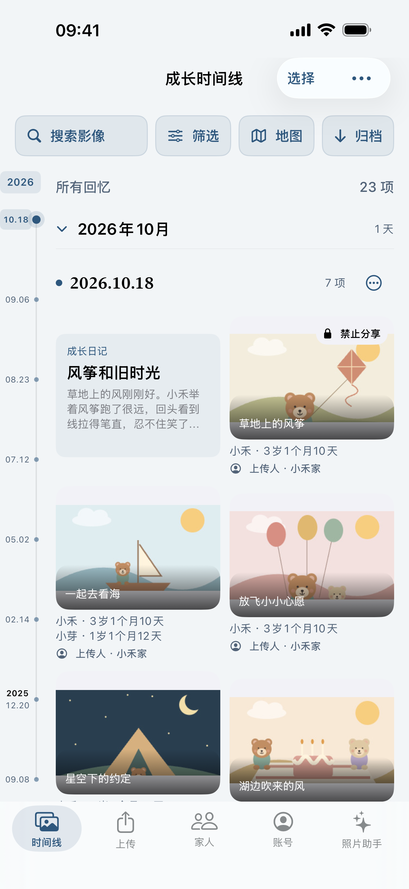
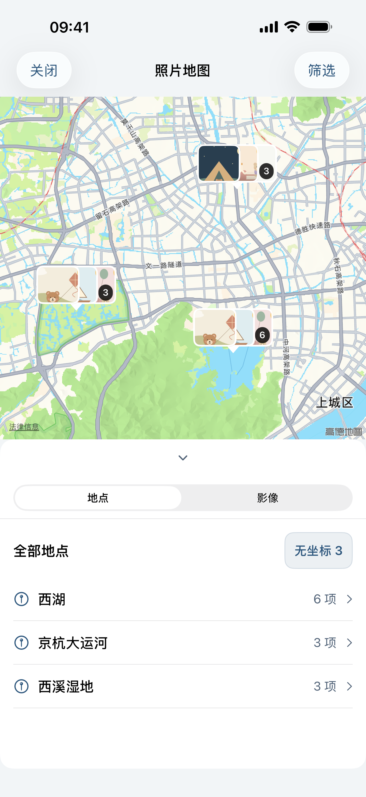
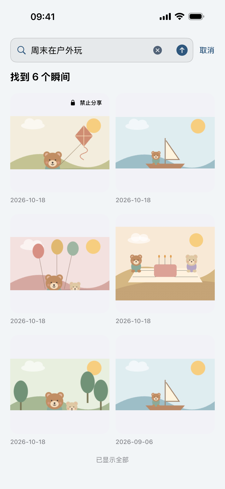
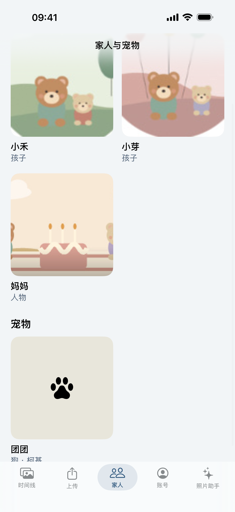
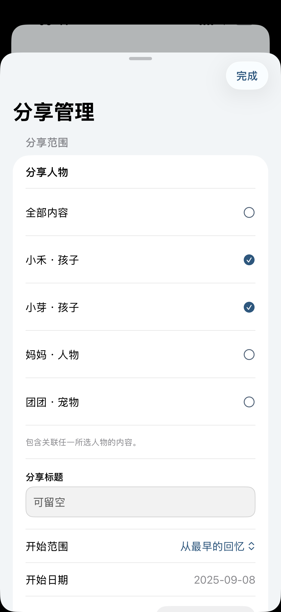
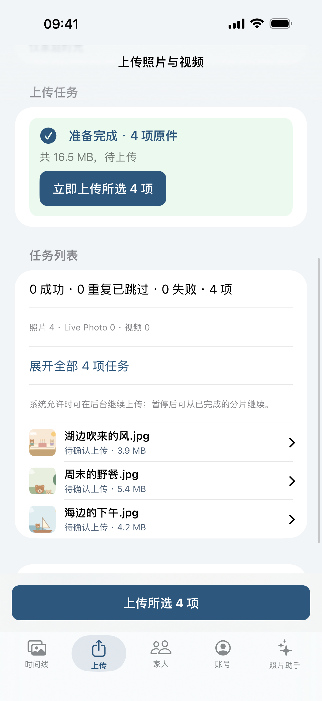
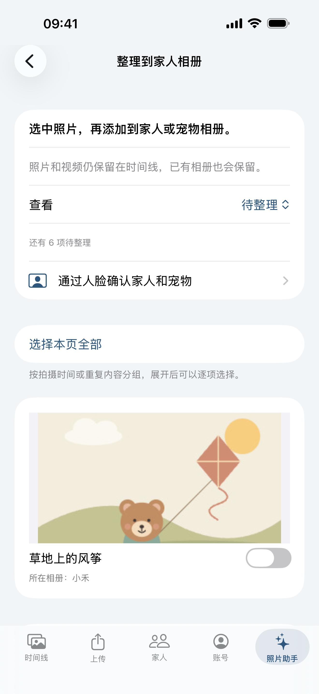
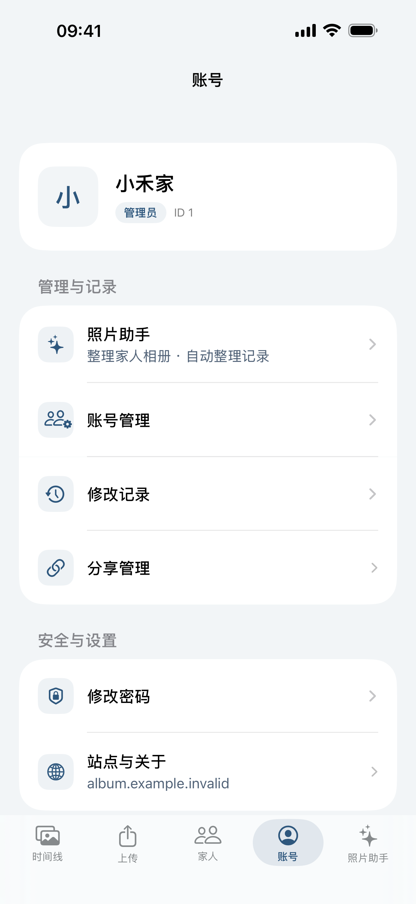

# Yearly

**简体中文** · [English](README.en.md)

Yearly 是一个可自行部署的家庭影像档案。照片、视频、实况照片和日记沿着同一条成长时间线归档。家人可以用 iPhone、Android 或网页浏览同一个家庭相册，也可以把一段回忆限时分享给亲友。

[界面预览](#界面预览) · [功能](#功能) · [快速开始](#快速开始) · [手机安装](#手机安装) · [部署与维护](#部署与维护)

## 界面预览

### iPhone

| 成长时间线 | 照片地图 | 成长日记 |
| :---: | :---: | :---: |
| <a href="docs/images/demo-ios-timeline.png"></a> | <a href="docs/images/demo-ios-map.png"></a> | <a href="docs/images/demo-ios-diary.png"></a> |

| 智能搜索 | 家人与宠物 | 限时分享 |
| :---: | :---: | :---: |
| <a href="docs/images/demo-ios-search.png"></a> | <a href="docs/images/demo-ios-family.png"></a> | <a href="docs/images/demo-ios-share.png"></a> |

<details>
<summary>查看原片上传、媒体预览、照片助手与账号</summary>

| 原片上传 | 媒体预览 | 照片助手 | 账号 |
| :---: | :---: | :---: | :---: |
| <a href="docs/images/demo-ios-upload.png"></a> | <a href="docs/images/demo-ios-preview.png"></a> | <a href="docs/images/demo-ios-assistant.png"></a> | <a href="docs/images/demo-ios-account.png"></a> |

</details>

### 网页分享

亲友打开链接就能浏览只读相册。分享页与 iOS 时间线采用相同的月份和日期分组，可拖动日期轴定位，点开影像全屏浏览，或独立阅读日记。孩子档案启用成长记录后，已关联的影像可根据拍摄日期和生日显示拍摄时年龄。 [分享使用指南](docs/sharing.md)

<a href="docs/images/demo-share.png"></a>

截图来自运行中的 iOS 模拟器和网页，使用虚构的家庭档案、影像和日记。点击图片可查看完整尺寸。 [截图说明](docs/images/ios-screenshots.md)

## 功能

- **浏览与整理。** 按天归档照片、视频、实况和日记，按月折叠，用日期轴快速跳转。同一天内可混排媒体和文件夹，批量移动并调整顺序。iOS 照片地图按拍摄坐标聚合影像，点开地点可浏览同地点照片。 [存储与地图](docs/storage-and-metadata.md)
- **记录成长。** 为孩子、其他家人和宠物建立独立档案。一项回忆可关联多个档案，沿各自时间线浏览；孩子档案可查看拍摄时年龄与成长节点。生日可留空。 [人物与宠物](docs/pets.md)
- **保存原片。** iPhone 可从系统相册批量选取原件，实况照片的静态图和配对 MOV 作为同一项上传。上传队列支持暂停、重试及后台续传。原件存放于私有 OSS，日常浏览使用缩略图或压缩预览。 [iOS 上传与后台传输](ios/README.md)
- **限时分享。** 能按人物、归档日期或指定影像创建只读链接，有效期 1 小时至 7 天，可提前撤销。内容的分享权限会应用到已有链接，iOS 会为禁止分享的影像显示锁标记。 [分享范围与权限](docs/sharing.md)
- **家庭管理。** 一个部署服务一个家庭，管理员创建账号并分配成员或只读权限。服务端校验编辑权限并保留修改记录，删除的影像和日记可以从回收站恢复。

### 智能搜索与照片助手

在时间线输入“在海边玩沙”一类的描述，可以找回画面描述里没有原词的照片和视频。搜索沿用当前筛选，在有权限且已建立索引的内容中查找，每页 20 项，可继续翻看全部相关结果。管理员可在照片助手确认人物与狗狗匹配、复核画质，并将影像加入家人相册，也可开启自动标签。

智能搜索默认关闭。启用时需在服务端配置 OpenAI 密钥和月度预算，并运行索引任务。建索引会发送照片预览或视频采样帧，实况照片使用静态图；搜索使用已保存的画面描述。 [智能搜索配置](docs/ai-search.md) · [人物匹配与相册整理](docs/face-matching.md)

## 快速开始

本地运行需要 Python 3.12、Node.js 22.12+ 和 MySQL 5.7.8+。完整的上传和预览功能需要配置私有阿里云 OSS Bucket、访问权限和 CORS。 [MySQL 建库](docs/deployment.md#2-已有-mysql-实例创建应用库) · [OSS 配置](docs/storage-and-metadata.md#bucket-与-ram)

1. 安装依赖并准备测试配置。

   ```bash
   git clone https://github.com/NiuXiangQian/yearly.git
   cd yearly
   python3.12 -m venv .venv
   .venv/bin/pip install -r backend/requirements.txt
   (cd frontend && npm ci)
   cp -n .env.test.example .env.test
   chmod 600 .env.test
   ```

2. 编辑 `.env.test`，填写测试 MySQL 的连接信息、`SESSION_SECRET` 和 OSS 参数。测试库名以 `_test` 结尾，使用独立的数据库账号。可在本地生成随机 Session 密钥。

   ```bash
   .venv/bin/python -c 'import secrets; print(secrets.token_urlsafe(48))'
   ```

3. 执行迁移、创建首个管理员并启动。

   ```bash
   ./scripts/manage.sh test migrate
   ./scripts/manage.sh test create-admin your-admin-name
   ./scripts/start-local.sh
   ```

打开 [http://127.0.0.1:5173/](http://127.0.0.1:5173/) 登录。`Ctrl+C` 会一起停止前端、API 和视频预览进程。

## 手机安装

| 客户端 | 安装方式 |
| --- | --- |
| **iOS 16+** | 用完整 Xcode 打开 `ios/Yearly.xcodeproj`，配置自己的 Apple Team 和签名，连接已打开开发者模式的 iPhone 并运行。 [iOS 构建与签名](ios/README.md) |
| **Android 8.0+** | 用 Android Studio 打开 `android/`，或从项目根目录运行 `./scripts/android.sh release` 生成安装包。 [Android 构建与安装](android/README.md) |

在 App 中填写手机可访问、证书有效的 HTTPS 家庭站点完整地址，例如 `https://example.com/yearly/`，再用已有家庭账号登录。

## 部署与维护

后端使用 FastAPI、SQLAlchemy、Alembic 和 MySQL，Web 使用 Vue 3 与 TypeScript，原生端使用 SwiftUI 和 Jetpack Compose。正式部署使用独立的 `.env.production` 和生产数据库。Nginx 提供 HTTPS，systemd 运行 API 和视频预览工作进程。升级前先备份，再执行数据库迁移。 [部署指南](docs/deployment.md)

原始拍摄信息与手工修正分开保存，预览生成不会覆盖原件。数据库保存元数据和关联信息，完整备份还需包含 OSS 原件和清单。 [存储与元数据](docs/storage-and-metadata.md) · [备份与恢复](docs/backup-restore.md)

日常验证可运行以下命令。完整前后端测试使用独立的测试 MySQL。

```bash
(cd frontend && npm test && npm run build)
./scripts/test.sh
./scripts/ios.sh verify
```

[验证范围](docs/verification.md) · [部署模板](deploy/) · [管理脚本](scripts/)
