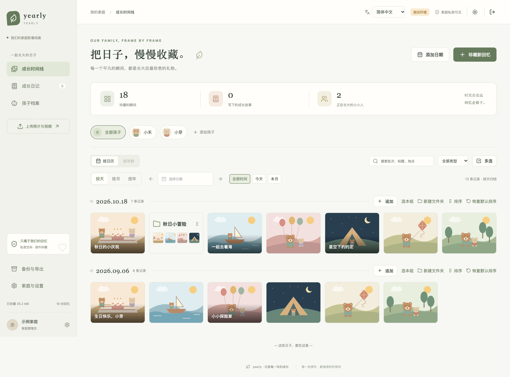
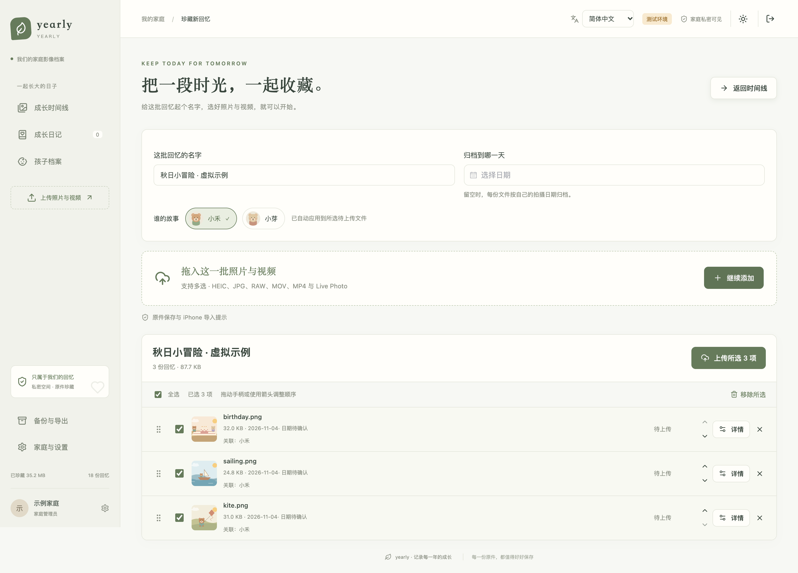
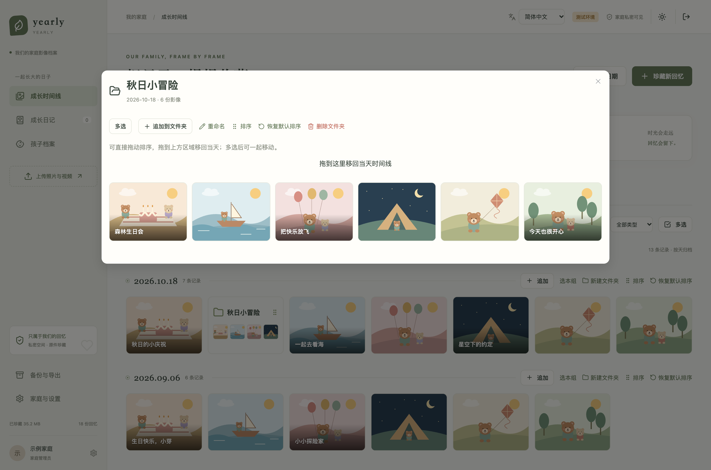
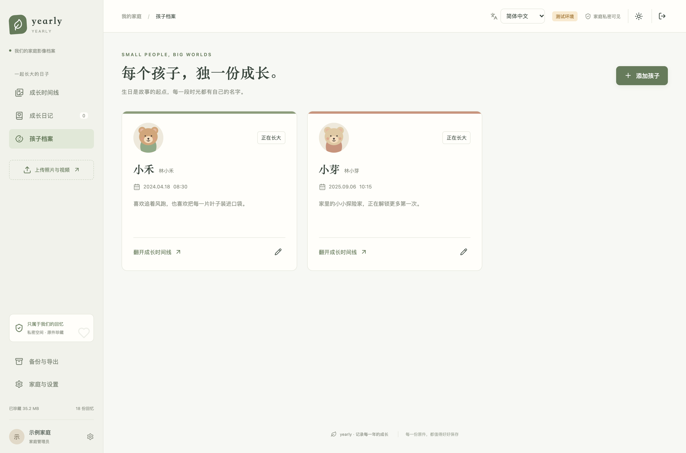

# yearly

**简体中文（默认）** | [English](README.en.md)

**让成长有迹可循。**

一个可自行部署的私人家庭影像档案。把照片、视频与成长日记按日期和孩子整理，在多年以后，依然能找到每一个值得记住的瞬间。

按天时间线 · 多孩子档案 · 文件夹自由混排 · 压缩预览 · 原件备份

[界面预览](#界面预览) · [快速开始](#快速开始) · [部署指南](docs/deployment.md) · [备份与恢复](docs/backup-restore.md)

## 界面预览

截图来自实际应用界面，使用独立的虚拟数据。人物姓名、生日、记录和数量均为虚构，头像与影像为原创示例插画，不包含真实家庭照片或账户。以下图片均为 2 倍像素、3024px 宽的无损 PNG，可点击图片或下方链接查看高清原图。

### 按天收藏，自由整理

照片、视频和文件夹可以在同一天内拖动混排；文件夹显示小预览，自定义标题叠加在图片上。



[查看时间线高清原图](docs/images/demo-timeline.png)

### 一批回忆，一次整理

上传前命名批次、选择孩子、调整归档日期，紧凑文件列表支持多选、拖动排序和查看详情。



[查看上传页高清原图](docs/images/demo-upload.png)

<details>
<summary>查看文件夹整理与孩子档案</summary>

### 一个文件夹，留住一段故事

支持批量选择、追加上传、拖入 / 拖出文件夹、内部排序和恢复默认排序。



### 每个孩子，独一份成长

为孩子设置独立头像、生日和简介，再按孩子筛选共同回忆。



</details>

## 可以做什么

| 场景 | 功能 |
| --- | --- |
| 整理回忆 | 按天归档、命名文件夹、文件夹与影像混排、批量选择与移动、恢复默认排序 |
| 记录成长 | 多孩子档案、独立头像、按年龄浏览、满月 / 百天 / 生日导航、共同成长日记 |
| 批量上传 | 批次命名、EXIF / QuickTime 时间解析、跨日期追加提示、跨批次去重、分片上传与重试 |
| 轻量浏览 | 图片缩略图、HEIC / HEIF 预览、图片缩放拖动、视频压缩副本、按需查看原文件 |
| 珍藏原件 | 私有 OSS 直传、Live Photo 双文件配对、原始元数据保留、备份与完整性校验 |
| 家庭共享 | 管理员 / 成员 / 只读访客、登录验证码、回收站、中英文切换、浅色 / 深色主题、响应式布局 |

一个部署实例对应一个家庭，启用的账户共享家庭内容。它不提供公开注册，也不是多租户相册服务。

## 技术与存储

- **后端：** Python 3.12、FastAPI、SQLAlchemy 2、Alembic。
- **前端：** Vue 3、TypeScript、Vite、Pinia、Element Plus。
- **数据库：** MySQL 5.7.8+；开发、测试与生产使用独立配置，不使用 SQLite 替代。
- **文件：** 阿里云私有 OSS；原件由浏览器直传，数据库保存元数据和关联关系。
- **部署：** Nginx + systemd；独立工作进程生成视频预览，无需 Redis。

默认浏览使用压缩预览。只有主动选择“查看原文件”时才加载原件；预览处理不会覆盖原始文件。视频首次转码需要读取原件，并占用临时磁盘空间。

## 界面语言与日期选择

默认使用简体中文。登录页、页面右上角和家庭设置中都可切换 English；选择保存在当前浏览器，刷新后继续生效。菜单、表单、提示和日历同步切换，孩子姓名、文件名和日记内容保持原样。

时间线提供“按天 / 按月 / 按年”筛选、前后日期切换，以及“全部时间 / 今天 / 本月 / 出生当天”快捷入口（选择一个孩子后显示出生当天）。日历支持直接输入，也可点击顶部年份或月份快速定位；孩子生日、上传归档日期和日记时间使用同一套日期控件。

## 快速开始

### 1. 准备依赖

需要 Python 3.12、Node.js 22.12+、MySQL 5.7.8+ 和私有 OSS Bucket。完整上传与预览功能需要配置 OSS 的权限、CORS 和对应地域，详见[存储配置](docs/storage-and-metadata.md)。

```bash
git clone https://github.com/NiuXiangQian/yearly.git
cd yearly

# 安装了 nvm 时，可用 nvm use 读取 .nvmrc
python3.12 -m venv .venv
.venv/bin/pip install -r backend/requirements.txt
(cd frontend && npm ci)

cp -n .env.test.example .env.test
chmod 600 .env.test
```

### 2. 填写本地配置

编辑 `.env.test`，设置自己的数据库连接、Session 密钥及 OSS 参数。测试数据库名必须以 `_test` 结尾，使用仅有该库权限的应用账号。

可在本机生成 Session 密钥，将输出保存到配置文件，不要提交到 Git：

```bash
.venv/bin/python -c 'import secrets; print(secrets.token_urlsafe(48))'
```

示例配置中的 `CHANGE_ME`、`your-private-bucket` 等只是占位符，不能直接作为真实部署配置。数据库初始化示例见[部署指南](docs/deployment.md)。

### 3. 建表并启动

```bash
./scripts/manage.sh test migrate

# 首次运行时创建管理员，按提示输入密码
./scripts/manage.sh test create-admin your-admin-name

./scripts/start-local.sh
```

访问 [http://127.0.0.1:5173/](http://127.0.0.1:5173/)。启动脚本同时运行 API、前端和视频预览进程，按 `Ctrl+C` 一起停止。

需要分别启动时：

```bash
./scripts/start-api.sh test --reload
(cd frontend && npm run dev -- --port 5173)
./scripts/manage.sh test generate-previews --watch
```

上面三个命令分别在三个终端运行。

## 环境与部署

| 配置 | 本地测试 | 正式环境 |
| --- | --- | --- |
| 环境选择 | `APP_ENV=test` | `APP_ENV=production` |
| 配置文件 | `.env.test` | `.env.production` |
| 数据库 | 名称以 `_test` 结尾 | 独立正式库，不能以 `_test` 结尾 |
| 访问方式 | 本机 HTTP | HTTPS 与 Secure Cookie |
| 数据库账号、密钥、OSS 配置 | 单独配置 | 单独配置 |

新部署使用 Alembic 建表；升级已有部署时先备份，再迁移数据库。当前迁移版本为 `0006`。生产部署需同时运行 API 和视频预览工作进程，并配置 Nginx、私有 OSS 及备份任务。

具体步骤见[部署指南](docs/deployment.md)。仓库提供的是应用与部署模板，不包含可直接使用的服务器、数据库或 OSS 凭据。

## 验证与开发

```bash
# 前端测试与构建
(cd frontend && npm test && npm run build)

# 前后端完整检查：先配置独立的测试 MySQL，并执行迁移
./scripts/test.sh
```

后端测试使用 MySQL 和事务回滚，OSS 操作使用 Mock，包含独立的签名与合成媒体测试。运行数据库测试前先停止连接同一测试库的服务，避免同时写入。

验证范围与待验收项目见[验证说明](docs/verification.md)。

## 数据边界与隐私

- 成员可以编辑整个家庭的内容，访客只读；管理员管理账户、孩子删除和导出。账户之间不是独立的私有空间。
- 保存浏览器实际选择的文件字节。手机相册可能转换格式或省略 Live Photo 资源，导入前应确认原片导出方式。
- 原始拍摄时间与手工修正独立保存；缺失的时间、时区或 GPS 不会被补造。
- 删除影像和日记进入回收站；删除文件夹只移除分类。系统不会自动永久删除原件。
- 恢复备份需要维护窗口和停写。不要把唯一一份家庭原件只交给单一存储副本。
- `.env`、密码、私钥、证书、数据库导出、原始照片和带个人信息的日志不要上传到仓库或 Issue。公开截图仅使用虚拟数据，分享前同时检查图片的 EXIF 元数据。

## 更多文档

| 文档 | 内容 |
| --- | --- |
| [部署指南](docs/deployment.md) | MySQL、HTTPS、Nginx、systemd 与视频预览进程 |
| [存储与元数据](docs/storage-and-metadata.md) | OSS、直传、压缩预览、拍摄时间与归档规则 |
| [备份与恢复](docs/backup-restore.md) | 数据库、清单、原件备份及恢复流程 |
| [验证说明](docs/verification.md) | 已验证范围、测试命令与兼容性限制 |

部署模板位于 [`deploy/`](deploy/)，管理命令位于 [`scripts/`](scripts/)。
