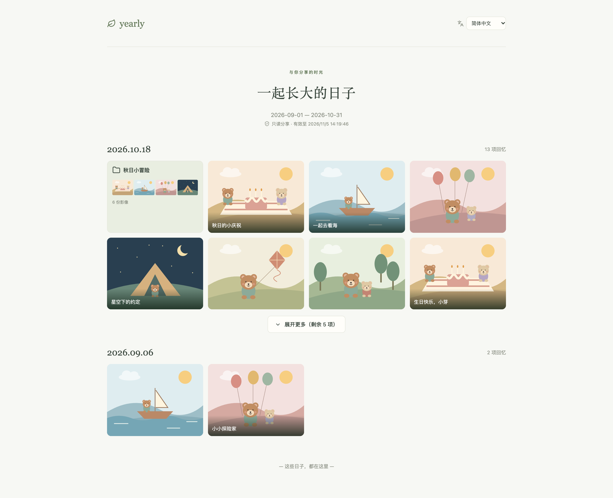

# Expiring timeline shares

[简体中文](../sharing.md) | **English** · [Home](../../README.en.md)

Click **Share timeline** at the top of the timeline. Admins and members can create links; viewers cannot create or revoke them.

1. Optionally enter a title and choose an inclusive start and end date. Sharing follows archive dates, independently of capture dates.
2. Choose **1–168 hours (up to 7 days)**, measured from successful creation.
3. Click **Review content in range** and select entire days, folders, individual files, or diaries to exclude. Expand a folder to exclude individual files. Excluding a day or folder hides everything inside it.
4. Create and copy the link, or preview it first. Save the full link before closing the dialog; it is only returned on creation.
5. Revoke links early under **Manage recent shares**. Members manage their own links; admins manage all links. The list shows the most recent 100.

Each link stores its own range and exclusions. It includes all children in those dates and does not inherit the main timeline's child, search, or media-type filters. Shares update with the timeline: new content in range appears unless excluded. To change a published link's scope, revoke it and create a new one.

Recipients need no account and read a separate, read-only timeline. Each day initially shows eight entries, with more available on demand. Folders and media retain their mixed order. Readers can open folders and diaries, zoom images, and play compressed videos and Live Photos. Undated files are outside date-range shares. The signed-in mobile timeline also folds entries beyond eight per day; selection and sorting modes show all entries for editing.

## Preview

This 2× lossless PNG shows the Chinese read-only view with fictional data only. The interface also supports English.



## Privacy and bandwidth

- Anyone with a link can read it. Share only with trusted recipients. This does not prevent screenshots or saving visible content.
- Public lists, folder thumbnails, counts, and media URLs enforce scope, exclusions, expiry, revocation, and creator permissions on the server.
- Only compressed thumbnails and previews are served. There is no original-download entry point. Unavailable video previews ask readers to retry; they never fall back to originals.
- Regular list payloads omit accounts, child profiles, original filenames, GPS, EXIF, and storage details. OSS previews use short-lived signed URLs; recipients can see the domain and object path, with the signature limited to that preview.
- **Custom titles and diary text are shared content.** Review private writing before sharing. Diaries do not expose original media associations or covers that could reveal excluded files.
- Expiry and revocation block new API access immediately. Previously issued preview URLs remain valid for at most 60 seconds, never beyond the share's remaining lifetime. Loaded or saved content cannot be recalled.
- The database stores only SHA-256 digests of random link tokens. Portable backups omit share links. Deactivating a creator or removing their editing role also disables their links.
- The frontend suppresses Referrer headers and requests no search indexing. The sample Nginx access log redacts share tokens; API access logging is disabled. Treat other proxy, monitoring, and error logs as sensitive.

## Migration

Alembic revision `0007` creates `timeline_share`; manual initialization SQL is also updated. Migrate test and production separately:

```bash
./scripts/manage.sh test migrate
# Back up production first; run during deployment:
./scripts/manage.sh production migrate
```

Deploy the backend, frontend build, and Nginx changes together. A link pointing to your own localhost is not reachable by external recipients; use a publicly reachable HTTPS deployment domain for real sharing.
