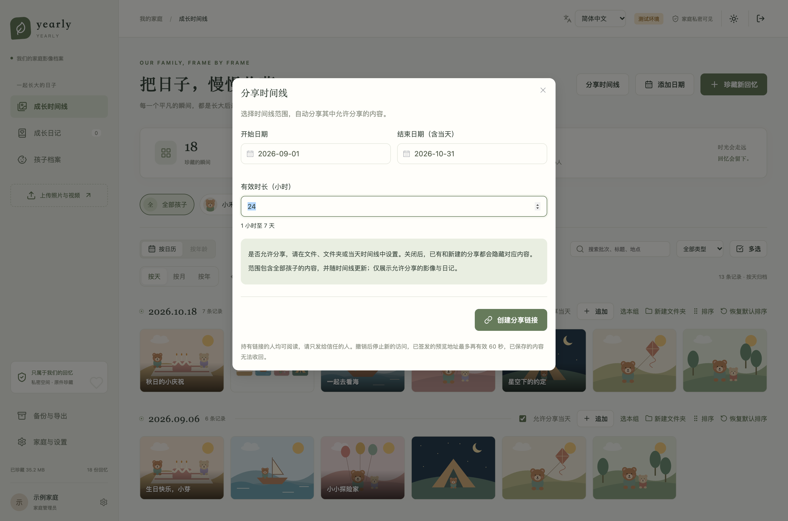
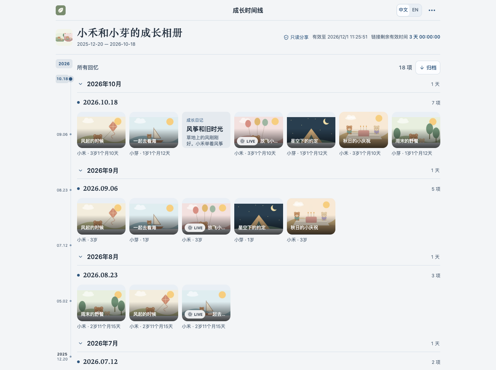
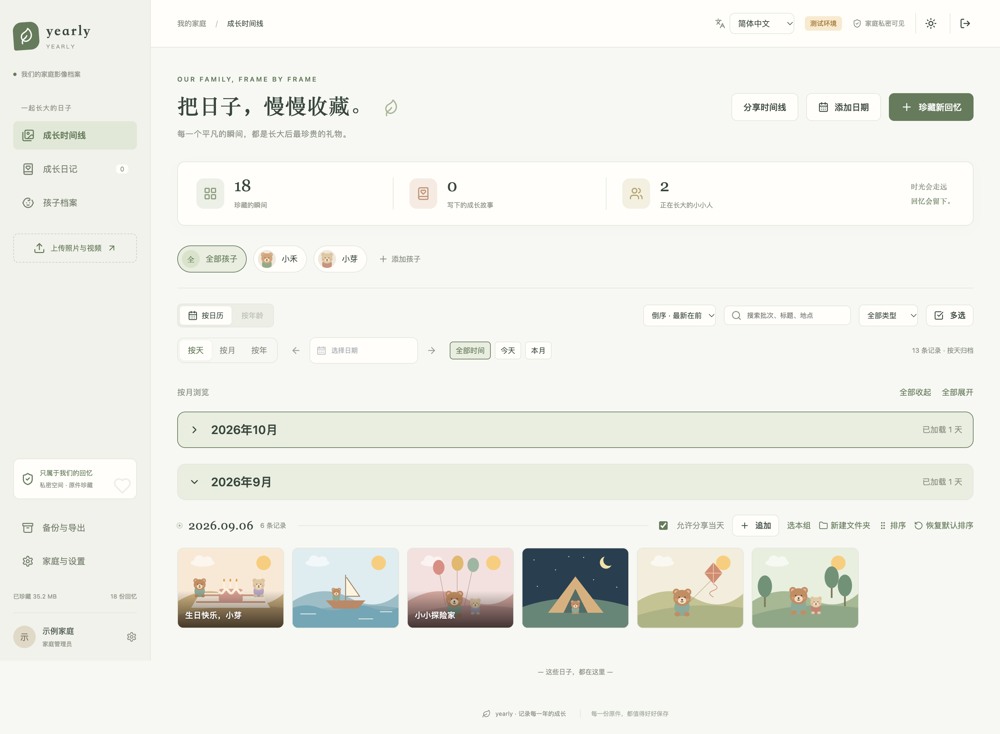
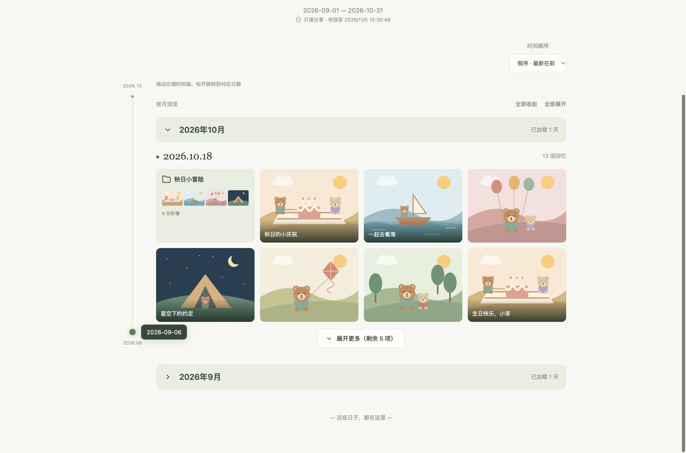

# Expiring timeline shares

[简体中文](../sharing.md) | **English** · [Home](../../README.en.md)

Set **Allow sharing** during normal content editing. When creating a link, choose the profiles, date range, and lifetime.

- **File:** open its details, change **Allow sharing** in the existing edit form, and save.
- **Folder:** open it, choose **Edit folder**, change **Allow sharing**, and save. Disabling a folder hides all its contents too.
- **Timeline day:** toggle **Allow sharing this day** in the date action bar. It saves immediately and controls all files, folders, and diaries on that day.
- **Diary:** change **Allow sharing** in its editor and save.

Sharing is allowed by default. These persistent settings apply to **all existing and new links**. A file is hidden if its parent folder or day disallows sharing, even when the file itself allows it. Enabling this option does not publish a link. Disabled content is visible only to administrators. Regular editors and viewers cannot see it in the signed-in management interface, timeline, search, folders, or diaries, even when they uploaded it themselves. Folder and day restrictions apply to their contents. Direct detail, preview, download, and edit requests enforce the same restrictions. Administrators retain access and can allow sharing again.

Click **Share timeline**:

1. Choose **Earliest, One year ago, Six months ago, or Custom date** for the start. Earliest uses the first archive date among currently shareable content. Relative dates use the local calendar and clamp to valid month-end dates (February 29 becomes February 28 one year earlier). The end date is inclusive, with a Today shortcut. Main-page child, search, and media-type filters do not scope the share.
2. **People to share** preselects child profiles. You can add other people or pets. Media and diaries linked to any selected profile appear once. Choose **All content** to include untagged items in the range. Selected-media shares on mobile can also be filtered by profile.
3. Choose **1–168 hours (up to 7 days)** from successful creation.
4. Create, copy, or preview the link. The server filters content using its saved sharing permissions.
5. Revoke links under **Manage recent shares**. Members manage their own links and can share their own content. Administrators manage all links and may share all authorized content. Day-wide sharing settings require an administrator. The list shows the latest 100. Viewers cannot create or modify sharing settings.

Shares update with the timeline and saved permissions, including new content allowed for sharing. To change a link's date range, revoke it and create a new link.

Media cards in both date-range and selected-media shares show each tagged child's display name and age at capture. Ages use the capture date, including any correction. A missing capture date, missing birthday, or disabled growth tracking omits the corresponding age.

Recipients need no account. The shared timeline follows the iOS archive layout. Authorized media from folders appear directly under their date, and folder sharing permissions still apply. Each day shows eight items at first and expands on demand. Selected-media links keep their chosen order in a flat list.

The **Archive** menu switches between newest first and oldest first. The browser remembers the choice. Changing direction reloads from that end while preserving manual item priority.

Tap a month to expand or collapse it. The top-right menu refreshes the timeline or expands and collapses both the months and the extra items within each day. Month headers show the number of loaded days.

The left rail appears when the share has multiple dates. Dragging follows dates already loaded, and releasing fetches an unloaded target date and opens its month. Tap a marker or use the arrow keys, Home, or End to jump. Ordinary scrolling updates the date marker.

Open media fullscreen and use swipes, arrow keys, or the previous and next buttons to browse across days. The viewer shows the item’s position within its day and the share. Journals open in a separate fullscreen reader.

Group shares use the same collage on the link card and the shared page. The cover takes the first nine configured avatars in profile-list order. **All content** draws from active family profiles by default. Unavailable images are omitted, and the Yearly logo appears if no avatars are available.

The link card uses your custom title. If you leave it blank, Yearly generates a title based on the selected profiles. The card description reflects whether the link shares a date range or selected media.

## Preview

These 2× lossless PNGs use fictional data. Set file permissions in their editors.









## Privacy and bandwidth

- Anyone with a link can read it. Share only with trusted recipients. This does not prevent screenshots or saving visible content.
- Public lists, date indexes, counts, and media URLs enforce scope, content permissions, expiry, revocation, and creator permissions on the server. The server selects the signed object from the authorized media record; client-supplied object paths, other file IDs, or download flags cannot expand access. Share tokens do not authenticate private original-download endpoints.
- Only compressed thumbnails and previews are served. There is no original-download entry point. Unavailable video previews ask readers to retry; they never fall back to originals.
- Media cards may include `child_ages`, with each child's display `name` and capture `age`. Regular list payloads omit accounts, child profile IDs, birthdays, original filenames, GPS, EXIF, and storage details. OSS previews use short-lived signed URLs; recipients can see the domain and object path, with the signature limited to that preview.
- **Custom titles and diary text are shared content.** Review private writing before sharing. Diaries do not expose original media associations or covers that could reveal excluded files.
- Expiry and revocation block new API access immediately. Previously issued preview URLs remain valid for at most 60 seconds, never beyond the share's remaining lifetime. Loaded or saved content cannot be recalled.
- The database stores only SHA-256 digests of random link tokens. Portable backups omit share links. Deactivating a creator or removing their editing role also disables their links. Changing a role revokes existing links. Copying another account’s link preserves its original content ownership scope.
- The frontend suppresses Referrer headers and requests no search indexing. The sample Nginx access log redacts share tokens; API access logging is disabled. Treat other proxy, monitoring, and error logs as sensitive.

## Migration

Alembic revision `0008` adds `share_allowed` to media, folders, and diaries, and stores day permissions in `timeline_day`. It removes per-link file selections and revokes old links with nonempty exclusions so their scope cannot silently expand. Portable backups retain these permissions and remain compatible with older backups. Manual initialization SQL is updated too. Migrate test and production separately:

```bash
./scripts/manage.sh test migrate
# Back up production first; run during deployment:
./scripts/manage.sh production migrate
```

Submit multiple profiles as the `profile_ids` array in `POST /api/shares`. An empty array includes all content in the selected range. Deploy with migration `0027` to preserve existing link tokens and profile scopes. For selected-media shares, the server applies the media selection, profiles, and sharing permissions together.

Deploy the backend, frontend build, and Nginx changes together. A link pointing to your own localhost is not reachable by external recipients; use a publicly reachable HTTPS deployment domain for real sharing.
