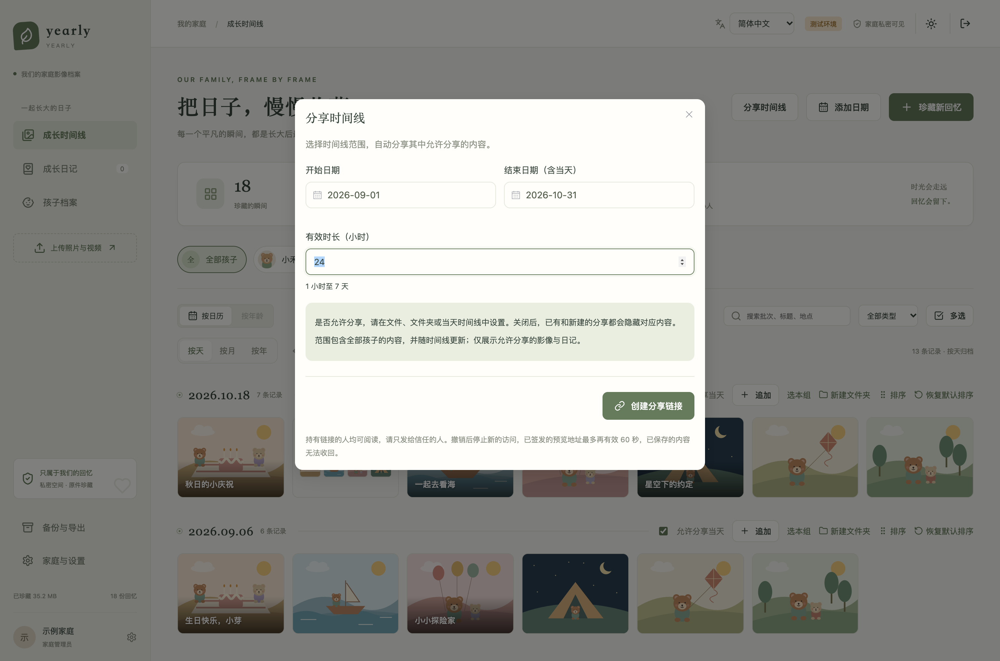
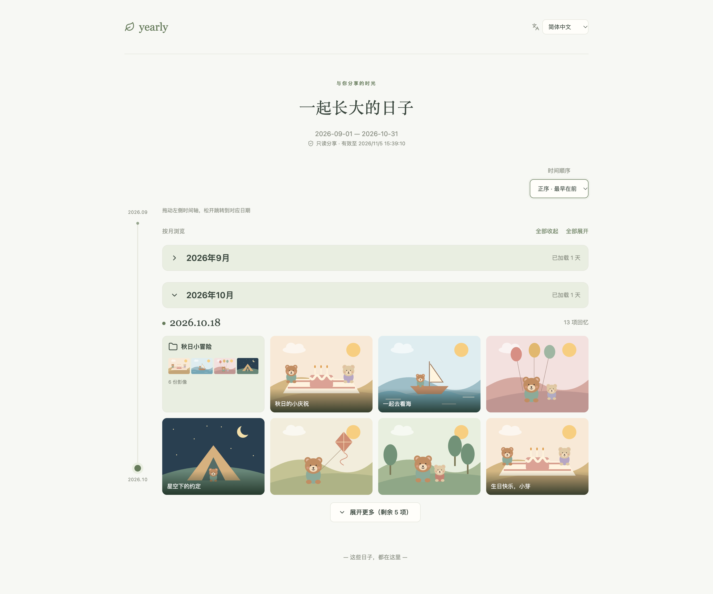
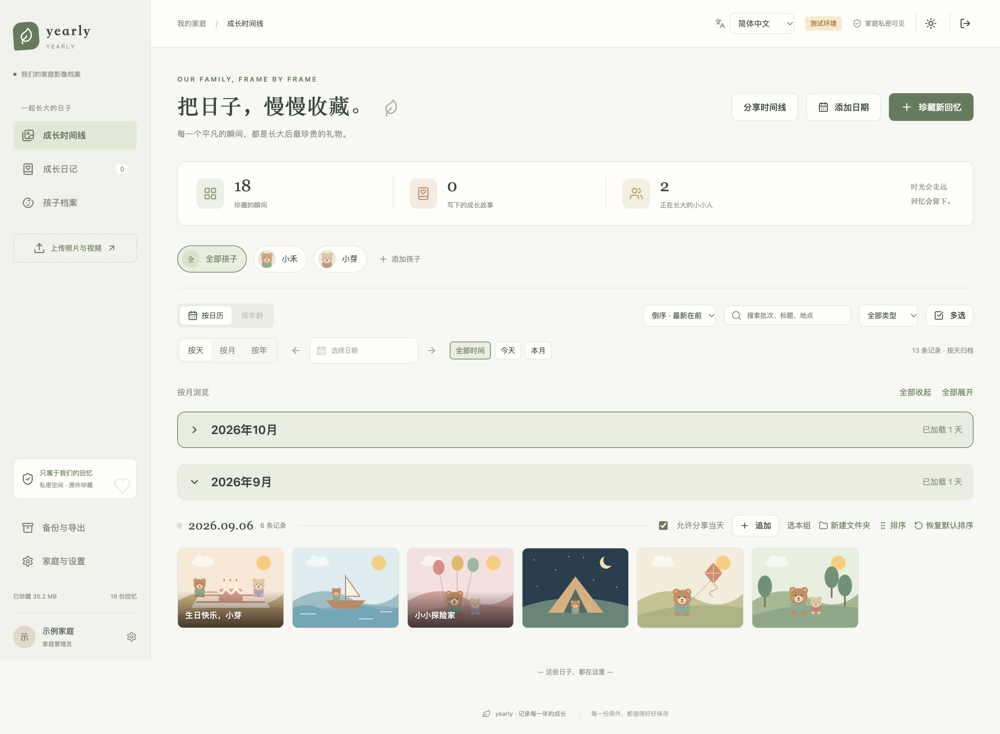
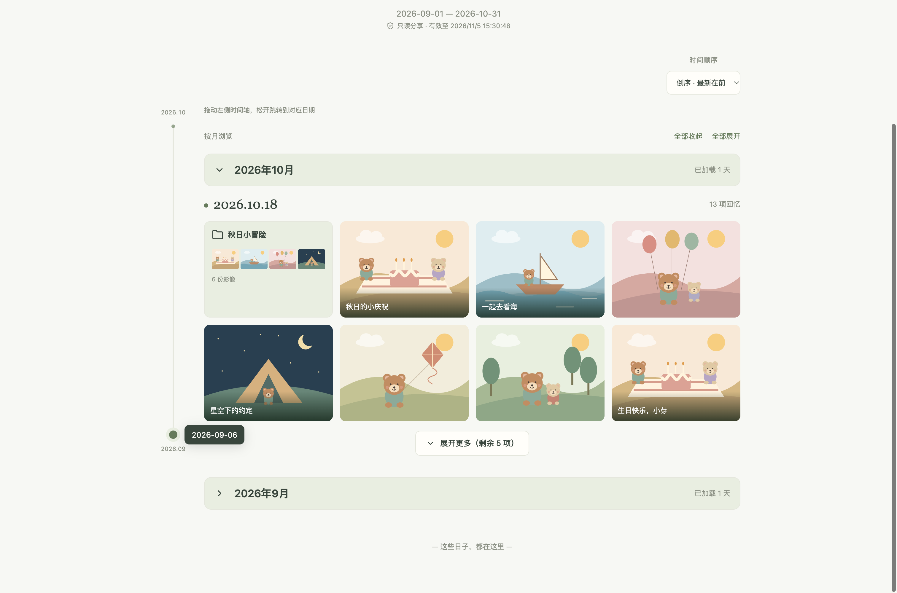

# 限时分享时间线

**简体中文** | [English](en/sharing.md) · [返回首页](../README.md)

先在日常编辑中设置内容的 **允许分享**，创建链接时只需选择时间线日期范围和有效时长。

- **文件：** 打开影像详情，在原有编辑表单中勾选 / 取消“允许分享”，保存。
- **文件夹：** 打开文件夹，点击“编辑文件夹”，设置“允许分享”并保存。关闭时整个文件夹及其内容均不分享。
- **当天时间线：** 在日期操作栏勾选 / 取消“允许分享当天”，自动保存。关闭时当天的全部文件、文件夹和日记均不分享。
- **成长日记：** 编辑日记时设置“允许分享”并保存。

默认允许分享。各项设置长期保存，对**已有和新建的全部分享链接**生效，无需重新创建链接。文件允许分享，但其所在文件夹或当天不允许时，仍然不会分享。开启“允许分享”本身不会生成公开链接；家庭内正常阅读、编辑和原件下载不受影响。

在时间线右上角点击 **分享时间线**：

1. 开始时间可选 **最早、一年前、六个月前、自选日期**；“最早”取当前允许分享内容的最早归档日期。相对日期按本机日历计算，月底自动取有效日期（例如闰年的 2 月 29 日往前一年为 2 月 28 日）。结束日期包含当天，也可点击“今天”。范围使用归档日期，不继承主页的孩子、搜索和媒体类型筛选。
2. 设置有效时长：**1–168 小时（最多 7 天）**，从创建成功时开始计算。
3. 创建并复制链接，也可点击“预览分享”。无需查看或勾选文件，服务端自动过滤不允许分享的内容。完整链接只在创建后显示，关闭窗口前请保存。
4. 在“管理最近的分享”中提前撤销链接。成员只能管理自己的链接，管理员可以管理全部链接；列表显示最近 100 条。只读访客不能创建或修改分享。

分享会跟随时间线和内容权限更新，范围内允许分享的新内容也会展示。修改内容权限不影响其他内容；若要改变链接的日期范围，请撤销后重新创建。

接收者无需登录，通过独立的只读时间线阅读。每天先显示 8 项，其余按需展开，文件夹和影像保留原来的混排顺序；支持打开文件夹、阅读日记、图片缩放、播放压缩视频与 Live Photo。日期未知的文件不会进入按日期范围创建的分享。登录后的手机时间线也会折叠每天第 9 项起的内容；多选与排序时展开以方便操作。

家庭时间线和分享阅读页均可切换 **倒序 · 最新在前 / 正序 · 最早在前**，默认倒序，分别记住本浏览器的阅读偏好。日期及未手动排序的拍摄时间跟随所选方向，手动混排优先级保持不变；家庭时间线中的未知日期仍排在最后。切换会重新加载分页，避免沿用旧方向的游标。

长时间线可点击月份标题，按月收起或展开，也可使用“全部收起 / 全部展开”。月份内仍按天阅读，原有每天八项折叠保持可用；继续分页时同月内容合并，并保留当前折叠状态。月份标注的是已加载的天数，不是整月总数。家庭时间线同样支持，进入多选或排序时会临时展开月份，退出后恢复。

分享页左侧提供可拖动时间轴，每个圆点代表一个允许查看的日期。拖动时显示日期，松开后跳转；也可聚焦时间轴后用方向键、Home / End 定位。月份已折叠时自动展开；未加载的日期按需获取，无需逐页翻到目标位置。时间轴顺序跟随正序 / 倒序，普通滚动时也会标记当前日期。拖动过程不请求媒体，日期索引和跳转接口均使用相同的分享范围与内容权限过滤。

## 界面预览

创建分享只选择日期和有效期，文件权限在原有编辑中管理。截图使用独立虚拟数据、2 倍像素无损 PNG，不包含真实家庭资料。









## 隐私与流量

- 持有链接的人均可阅读，请只发给信任的人。分享不是防截图或防保存机制。
- 所有公共列表、文件夹预览、数量和媒体地址接口都在服务端检查日期范围、内容分享权限、链接状态及创建者权限。签名对象由服务端根据获准的媒体记录确定；客户端传入对象路径、其他文件 ID 或下载参数不能扩大授权，分享令牌也不能访问私有原件接口。
- 分享页只使用压缩缩略图和预览，不提供原件下载入口；压缩视频未就绪时提示稍后重试，不回退到原文件。
- 常规列表不包含账号、孩子档案、原始文件名、GPS、EXIF 或存储对象信息。OSS 压缩预览使用短期签名 URL，域名及对象路径对接收者可见，签名只能用于对应预览。
- **自定义标题和成长日记正文属于分享内容。** 发布前请检查其中的私人文字。日记不返回原始关联媒体列表或封面，防止通过日记访问排除的文件。
- 到期或撤销后，新的 API 访问立即失效。已签发的预览地址有效期不超过 60 秒且不超过分享剩余时间；已加载或保存的内容不能远程收回。
- 数据库只存储随机链接令牌的 SHA-256 摘要。便携备份不导出分享链接；关闭创建者账号或取消其编辑权限后，链接也失效。
- 前端禁止发送 Referrer，并标记不允许搜索引擎索引。Nginx 示例访问日志隐藏分享令牌，API 服务禁用访问日志。其他代理、监控和错误日志仍应按敏感数据管理。

## 数据库升级

Alembic `0008` 为文件、文件夹和日记增加 `share_allowed`，并用 `timeline_day` 保存每天的权限；移除链接上的文件排除清单。为避免旧限制被放宽，升级会撤销原先设过单独排除项的链接。便携备份保留内容权限和每天的设置，兼容旧备份。手工初始化 SQL 同步更新。测试环境与正式环境分别执行迁移：

```bash
./scripts/manage.sh test migrate
# 正式环境先备份，在部署时执行：
./scripts/manage.sh production migrate
```

本次正反序及快捷日期更新不新增数据库迁移，仍使用 `0008`。

发布需同时更新后端、前端构建产物与 Nginx 配置。本地链接使用本机地址时，外部接收者无法访问；实际分享应使用可访问的 HTTPS 部署域名。
