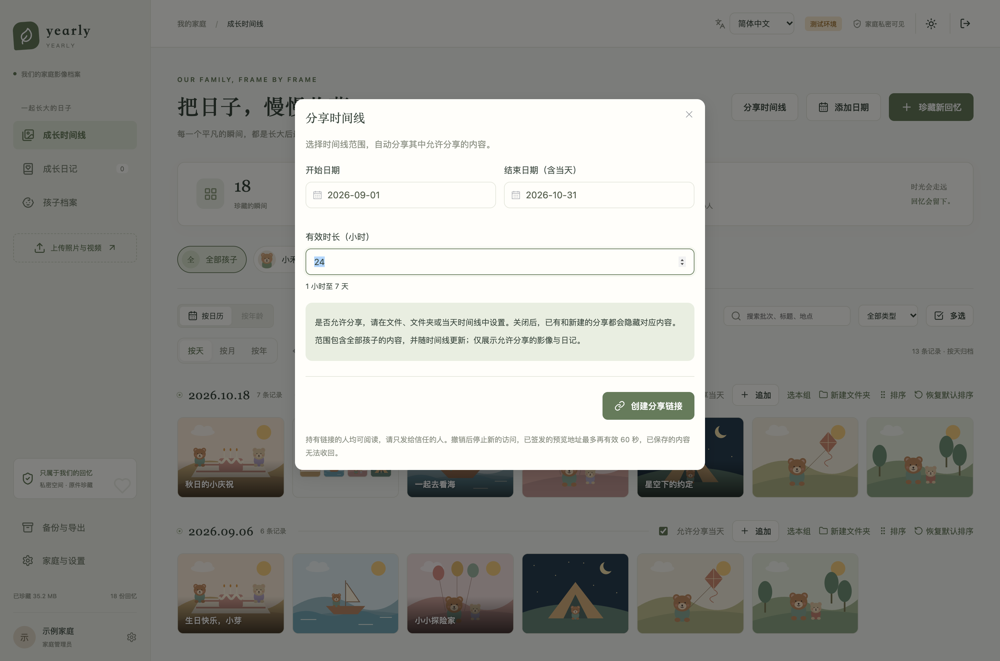
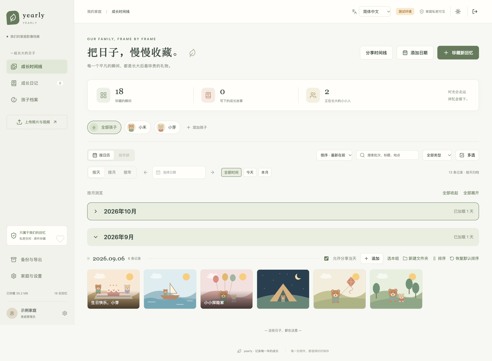
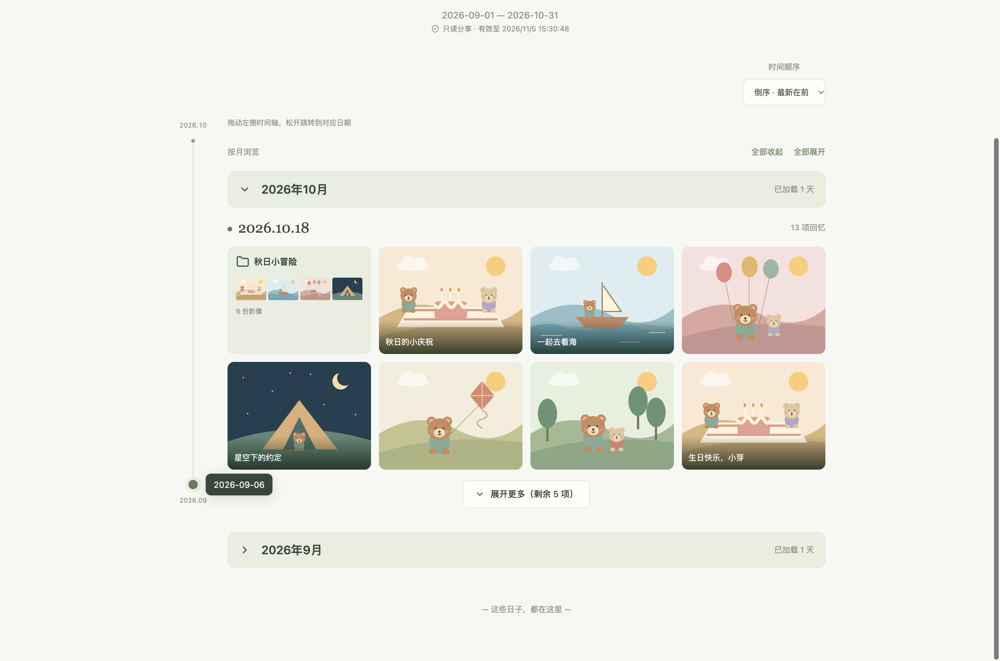

# 限时分享时间线

**简体中文** | [English](en/sharing.md) · [返回首页](../README.md)

先在日常编辑中设置内容的 **允许分享**。创建链接时可选择分享人物、日期范围和有效时长。

- **文件：** 打开影像详情，在原有编辑表单中勾选 / 取消“允许分享”，保存。
- **文件夹：** 打开文件夹，点击“编辑文件夹”，设置“允许分享”并保存。关闭时整个文件夹及其内容均不分享。
- **当天时间线：** 在日期操作栏勾选 / 取消“允许分享当天”，自动保存。关闭时当天的全部文件、文件夹和日记均不分享。
- **成长日记：** 编辑日记时设置“允许分享”并保存。

默认允许分享。各项设置长期保存，对**已有和新建的全部分享链接**生效，无需重新创建链接。文件允许分享，但其所在文件夹或当天不允许时，仍然不会分享。开启“允许分享”本身不会生成公开链接。关闭后，该内容仅管理员可见；普通编辑者和只读账号在登录后的管理端、时间线、搜索、文件夹及日记中也不可见，即使内容由本人上传。文件夹或日期的限制会继承到其中的内容，普通账号不能通过直接访问详情、预览、下载或修改接口绕过限制。管理员仍可查看并重新开放分享。

在时间线右上角点击 **分享时间线**：

1. 开始时间可选 **最早、一年前、六个月前、自选日期**；“最早”取当前允许分享内容的最早归档日期。相对日期按本机日历计算，月底自动取有效日期（例如闰年的 2 月 29 日往前一年为 2 月 28 日）。结束日期包含当天，也可点击“今天”。范围使用归档日期，不继承主页的孩子、搜索和媒体类型筛选。
2. **分享人物**默认勾选孩子档案，也可多选其他人物或宠物。影像或日记关联任一所选档案即可入选，同一项只出现一次。选“全部内容”可分享范围内未关联人物的回忆。指定影像分享也可以按人物筛选。
3. 设置有效时长 **1–168 小时（最多 7 天）**，从创建成功时开始计算。
4. 创建并复制链接，也可点击“预览分享”。服务端自动过滤不允许分享的内容。
5. 在“管理最近的分享”中提前撤销链接。成员只能管理自己的链接，管理员可以管理全部链接；列表显示最近 100 条。只读访客不能创建或修改分享。

普通账户创建的分享仅包含自己添加的内容，管理员可分享全部获准内容。普通账户无法修改全家的日期级分享开关。分享会跟随时间线和内容权限更新，范围内允许分享的新内容也会展示。修改内容权限不影响其他内容；若要改变链接的日期范围，请撤销后重新创建。

接收者无需登录。分享页与 iOS 时间线同样按归档月份和日期分组。文件夹中的获准影像直接显示在当天，文件夹的分享设置继续控制内容是否可见。每天先显示 8 项，其余按需展开。指定影像分享按所选顺序平铺。

日期范围和指定影像分享中的影像卡片显示已关联孩子的称呼和拍摄时年龄。年龄按实际拍摄日期（包括更正后的日期）计算。拍摄日期或生日缺失，以及档案关闭成长记录时，省略对应年龄。

在“归档”菜单切换从新到旧或从旧到新，默认从新到旧。切换会从相应端重新加载，影像的手动排序优先级保持不变。

点击月份标题可展开或收起该月。右上角菜单提供刷新、“展开全部回忆”和“收起全部回忆”，同时控制月份和每天第 9 项起的内容。月份旁显示已加载天数。

有多个日期时显示左侧日期轴。拖动即时跟随已加载日期，松手后按需请求尚未加载的目标日期，并展开其所在月份。点击刻度或用方向键、Home、End 也能定位。滚动会更新当前日期。

点击影像后全屏查看，可以左右滑动、用方向键或点击箭头在影像间切换。跨日继续加载，并显示当天和全部影像中的位置。日记独立全屏阅读。视频和 Live Photo 使用分享授权的压缩预览。

多人分享的链接卡片和分享页使用同一张头像拼图。封面按人物列表顺序取所选档案的前 9 张头像；选择「全部内容」时默认从当前家庭档案中取图。无法使用的头像会省略，没有可用头像时显示 Yearly 标志。

链接卡片使用你填写的分享标题。留空时会按所选档案生成标题，例如“小禾的成长相册”。卡片说明会区分日期范围和指定影像。

## 界面预览

文件的分享权限在编辑文件时管理。截图使用独立虚拟数据、2 倍像素无损 PNG。








## 隐私与流量

- 持有链接的人均可阅读，请只发给信任的人。分享不是防截图或防保存机制。
- 所有公共列表、日期索引、数量和媒体地址接口都在服务端检查日期范围、内容分享权限、链接状态及创建者权限。签名对象由服务端根据获准的媒体记录确定；客户端传入对象路径、其他文件 ID 或下载参数不能扩大授权，分享令牌也不能访问私有原件接口。
- 分享页只使用压缩缩略图和预览，不提供原件下载入口；压缩视频未就绪时提示稍后重试，不回退到原文件。
- 影像卡片可包含 `child_ages`（由孩子的显示名 `name` 和拍摄时年龄 `age` 组成）。常规列表不包含账号、孩子档案 ID、生日、原始文件名、GPS、EXIF 或存储对象信息。OSS 压缩预览使用短期签名 URL，域名及对象路径对接收者可见，签名只能用于对应预览。
- **自定义标题和成长日记正文属于分享内容。** 发布前请检查其中的私人文字。日记不返回原始关联媒体列表或封面，防止通过日记访问排除的文件。
- 到期或撤销后，新的 API 访问立即失效。已签发的预览地址有效期不超过 60 秒且不超过分享剩余时间；已加载或保存的内容不能远程收回。
- 数据库只存储随机链接令牌的 SHA-256 摘要。便携备份不导出分享链接；关闭创建者账号或取消其编辑权限后，链接也失效。更改账户角色时会撤销该账户已有分享，复制其他账户的分享会保留原内容归属范围。
- 前端禁止发送 Referrer，并标记不允许搜索引擎索引。Nginx 示例访问日志隐藏分享令牌，API 服务禁用访问日志。其他代理、监控和错误日志仍应按敏感数据管理。

## 数据库升级

Alembic `0008` 为文件、文件夹和日记增加 `share_allowed`，并用 `timeline_day` 保存每天的权限；移除链接上的文件排除清单。为避免旧限制被放宽，升级会撤销原先设过单独排除项的链接。便携备份保留内容权限和每天的设置，兼容旧备份。手工初始化 SQL 同步更新。测试环境与正式环境分别执行迁移：

```bash
./scripts/manage.sh test migrate
# 正式环境先备份，在部署时执行：
./scripts/manage.sh production migrate
```

人物多选通过 `POST /api/shares` 的 `profile_ids` 数组提交。空数组代表全部内容。部署需迁移至 `0027`，已有链接的令牌和人物范围会保留。分享指定影像时，服务端会同时核对影像清单、人物和分享权限。

发布需同时更新后端、前端构建产物与 Nginx 配置。本地链接使用本机地址时，外部接收者无法访问；实际分享应使用可访问的 HTTPS 部署域名。
